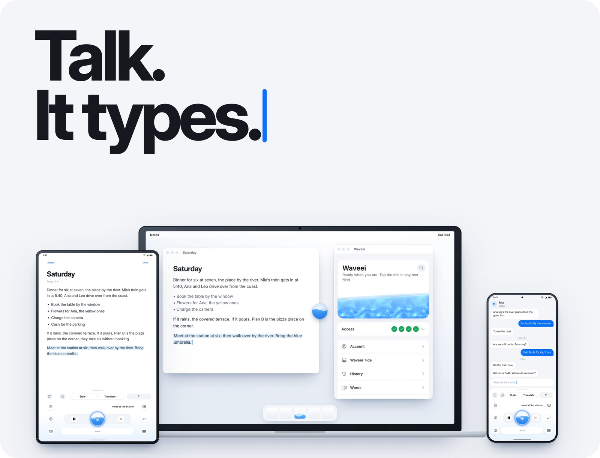
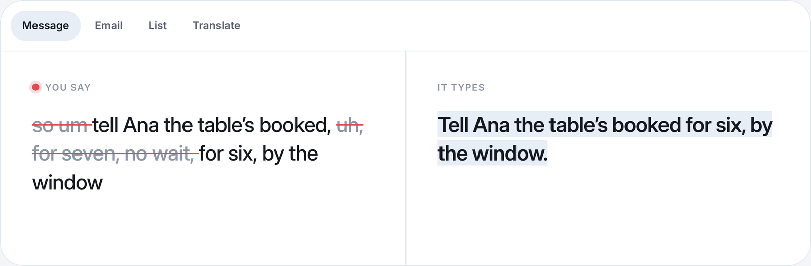
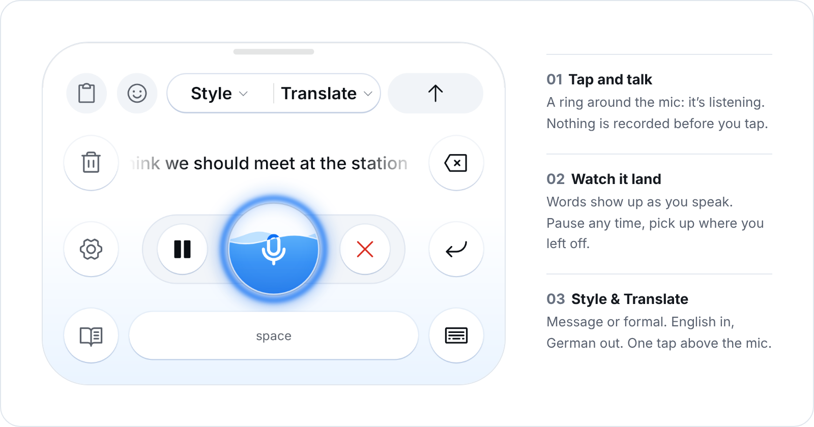
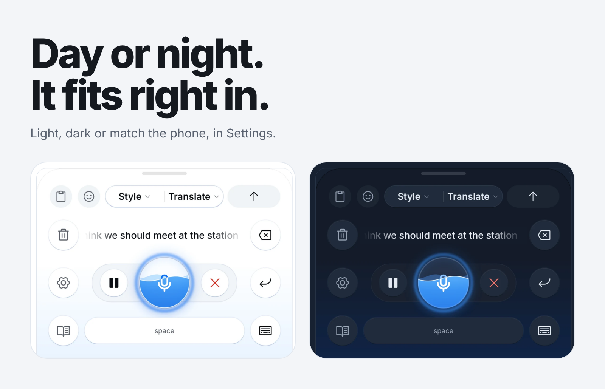
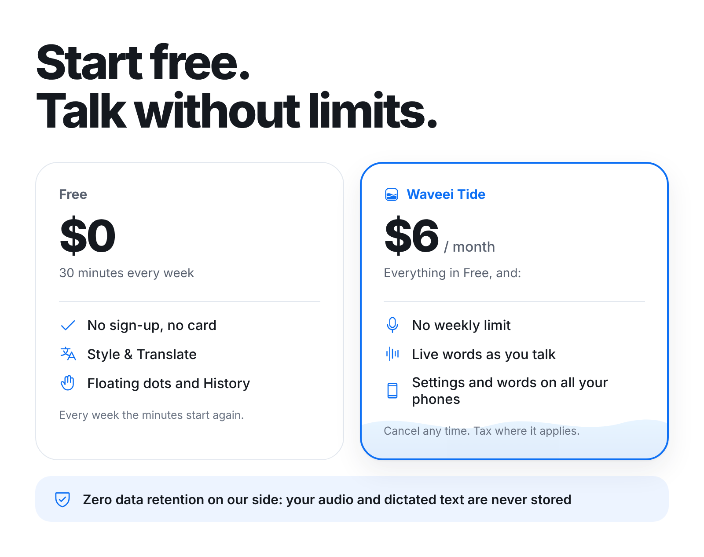

<picture>
  <source media="(prefers-color-scheme: dark)" srcset=".github/assets/hero-dark.png">
  
</picture>

<br>

<p align="center">
<b>You talk faster than you type.</b> Waveei turns what you say into clean text, right where you are typing.<br>
Cross-platform by design. Now on Android.
</p>

<p align="center">
<a href="https://github.com/waveeihq/waveei/releases/latest"><picture><source media="(prefers-color-scheme: dark)" srcset=".github/assets/button-get-dark.png"></picture></a>
&nbsp;
<a href="PRIVACY.md"><picture><source media="(prefers-color-scheme: dark)" srcset=".github/assets/button-privacy-dark.png"></picture></a>
&nbsp;
<a href="#build"><picture><source media="(prefers-color-scheme: dark)" srcset=".github/assets/button-build-dark.png"></picture></a>
</p>

<br>

<picture>
  <source media="(prefers-color-scheme: dark)" srcset=".github/assets/demo-dark.png">
  
</picture>

<picture>
  <source media="(prefers-color-scheme: dark)" srcset=".github/assets/keyboard-dark.png">
  
</picture>

## Beyond dictation

- **Over any app, with any keyboard.** The record dot floats over every app and types into the field in front,
  whichever keyboard is open.
- **Sends it for you.** With Auto-send on, Waveei presses the app's Send button once the text is in.
- **Your tone.** Message keeps it casual, Formal polishes it.
- **Into another language.** Speak in yours, and the text comes in the language you pick under Translate.
- **Nothing lost.** A dictation that fails stays on the phone to try again, and History keeps the last few to insert
  again.
- **Your words.** Add names and jargon to your Vocabulary, and Waveei spells them your way.

<picture>
  <source media="(prefers-color-scheme: dark)" srcset=".github/assets/themes-dark.png">
  
</picture>

<picture>
  <source media="(prefers-color-scheme: dark)" srcset=".github/assets/pricing-dark.png">
  
</picture>

## How it works

Speech is never recognized on the device. While you dictate, the app sends the recording to the Waveei server, which
asks a speech model for the text and sends it back.

> **Zero data retention on our side: your audio and dictated text are never stored.** Nothing you say is used to
> train models. Nothing is recorded before you tap the mic, and nothing from password fields. The full account of what
> leaves the phone, and for how long, is in [PRIVACY.md](PRIVACY.md).

The app needs the Waveei server, which is not part of this repository and not open source. Its API is in
[`core/src/main/kotlin/app/waveei/core/api/Api.kt`](core/src/main/kotlin/app/waveei/core/api/Api.kt).

| Module | What it is |
|:---|:---|
| [`android/`](android) | The Android app: the keyboard, the floating dots and the app's screens |
| [`core/`](core) | Logic with no Android in it: the server's API, text clean-up, the dictation buffer |
| [`golden/`](golden) | Input and expected output cases the core must pass on every platform |

## Install

The latest build is `waveei-<version>.apk` in this repository's [Releases](https://github.com/waveeihq/waveei/releases/latest),
for Android 13 or newer. The app looks for a newer one by itself and installs it when you tap Install (About › Updates).

Every build is signed with the same key. Its certificate's SHA-256, which `apksigner verify --print-certs waveei-<version>.apk`
shows:

```
CD:71:F5:51:BE:6F:DF:1F:26:F3:17:13:19:8C:C4:FD:19:37:BE:0F:B5:BE:53:67:10:B4:6F:B9:4B:18:2E:DC
```

A copy you built yourself has another key: uninstall it before installing a release.

## Build

JDK 21 and the Android SDK.

```sh
./gradlew :android:assembleDebug   # builds the app
./gradlew test                     # runs the tests
```

Accounts work only in builds signed with Waveei's key, so a build of your own runs but cannot dictate.

## Licence

Source-available under the Functional Source License 1.1, Apache 2.0 future licence ([LICENSE.md](LICENSE.md)): you
may use, change and share the code for anything but a competing product, and each version becomes Apache 2.0 two
years after its release. The Waveei name and logo are not licensed. Third-party parts are listed in
[THIRD_PARTY.md](THIRD_PARTY.md).

<br>

<p align="center">
<br>
<sub>
<a href="PRIVACY.md">Privacy</a> &nbsp;&nbsp;
<a href="TERMS.md">Terms</a> &nbsp;&nbsp;
<a href="SECURITY.md">Security</a> &nbsp;&nbsp;
<a href="CONTRIBUTING.md">Contributing</a> &nbsp;&nbsp;
<a href="THIRD_PARTY.md">Third party</a> &nbsp;&nbsp;
Feedback in the app
</sub>
</p>
